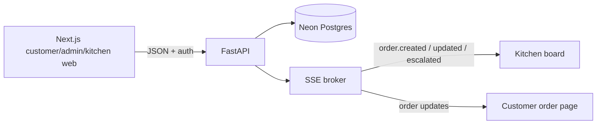

# Hyderabad Biryani direct ordering

Hyderabad Biryani is a direct ordering site for a 14-outlet biryani chain. It gives customers one trustworthy menu and sends paid orders to the correct outlet kitchen.
The client problem is 25–30% delivery-app commission, fragmented outlet menus, printed kitchen tickets, and no owned customer relationship.

## What is built

- Customer outlet selection, menu, photos, portions/add-ons, cart, mocked UPI/card checkout, order history, live status, GST-inclusive INR pricing, FSSAI and dietary labels.
- Central menu CMS for items, categories, photos, pricing, availability, and outlet controls.
- Kitchen board with SSE updates, polling fallback, timers, prep stages, late/escalated states, promise overrides, and item availability.
- Operations dashboard for orders, prep time, cancellations, repeat customers, and outlet comparison.

Out of scope for this slice: delivery-app integration, an own rider app, replacing billing or inventory, real payments/OTP/messages, and production-scale automation. These Must haves are not built: coupons, loyalty points, party order form, real WhatsApp/SMS, and delivery app integration.

## Architecture



Next.js owns responsive UI and local cart/session state. FastAPI owns authorization, server-side prices, order transitions, prep estimates, and SSE. Neon Postgres is durable storage; the in-process broker is sufficient for one API instance.

## Technology choices

Next.js, React, and TypeScript provide the app-router UI and type-safe client code. FastAPI and Pydantic provide a small async API with clear validation. SQLAlchemy and Alembic keep the Neon schema explicit. SSE is simpler than a socket protocol for one-way order updates and has a polling fallback. Playwright and axe-core cover browser accessibility checks; pytest covers API behavior.

## Windows setup

```powershell
cd api
python -m venv .venv
.\.venv\Scripts\python -m pip install -r requirements.txt
Copy-Item .env.example .env
# Set DATABASE_URL to the Neon connection string.
.\.venv\Scripts\python -m alembic upgrade head
.\.venv\Scripts\python -m app.seed
```

Run the API at `http://localhost:8010` and the web app at `http://localhost:3000`:

```powershell
cd api
.\.venv\Scripts\python -m uvicorn app.main:app --reload --port 8010

cd web
npm install
npm run dev
```

Development-only demo logins and passwords are documented in [api/README.md](api/README.md). Do not use them in production.

## Commands

```powershell
cd web
npm run lint
npm run typecheck
npm test

cd ..\api
.\.venv\Scripts\python -m pytest
.\.venv\Scripts\python -m scripts.load_test --base-url http://localhost:8010
.\.venv\Scripts\python -m scripts.seed_demo_history --confirm
.\.venv\Scripts\python -m scripts.cleanup_test_data
```

`seed_demo_history --confirm` creates development history; `seed_demo_history --remove` removes only its `7000` users/orders. Cleanup is a dry run unless `--apply` is supplied.

## Rules implemented

- Prices and availability are revalidated and calculated server-side.
- Customer prices are GST-inclusive and display `incl. 5% GST`.
- Promised time is the higher of the AI estimate and outlet minimum; a manager override wins.
- Orders escalate 10 minutes after the promise and notify the kitchen/customer through the app.
- Suggestions never add anything to the cart.

## Known limitations

SSE is single-instance and needs Redis or another shared broker to scale horizontally. Payments, OTP, and WhatsApp/SMS are mocked. The development token is stored in `localStorage`; production should use secure HttpOnly cookies and CSRF protection.

Design credit: [dickwu/apple-design-skill](https://github.com/dickwu/apple-design-skill).
