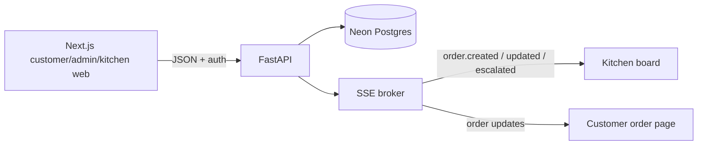

# Hyderabad Biryani direct ordering

Hyderabad Biryani is a direct ordering site for a 14-outlet biryani chain. It gives customers one trustworthy menu and sends paid orders to the correct outlet kitchen.
The client problem is 25–30% delivery-app commission, fragmented outlet menus, printed kitchen tickets, and no owned customer relationship.

## What is built

- Customer outlet selection, menu, photos, portions/add-ons, cart, mocked UPI/card checkout, order history, live status, GST-inclusive INR pricing, FSSAI and dietary labels.
- Central menu CMS for items, categories, photos, pricing, availability, and outlet controls.
- Kitchen board with SSE updates, polling fallback, timers, prep stages, late/escalated states, promise overrides, and item availability.
- Operations dashboard for orders, prep time, cancellations, repeat customers, and outlet comparison.
- Catering manager flow at `/catering` (catering or admin role): party order list with Requested, Confirmed, Completed, and Rejected tabs; confirm with optional adjusted total and manager note; reject with a required reason; mark completed after the event; 15-second polling while visible.

Party order rules:
- Customer needs at least 24 hours notice; the date picker disables earlier slots and server errors appear next to the field.
- Party orders are for 10 to 500 guests, up to 90 days ahead, with a Rs 3,000 minimum estimated total.
- Advance is 25% of the estimated total (mocked payment; no real payment keys).
- Statuses: Requested → Confirmed → Advance paid → Completed; Cancel when allowed.
- Suggestions are plain text only and never add anything to the order.

Out of scope for this slice: delivery-app integration, an own rider app, replacing billing or inventory, real payments/OTP/messages, real WhatsApp or SMS, and production-scale automation.

## Architecture



Next.js owns responsive UI and local cart/session state. FastAPI owns authorization, server-side prices, order transitions, prep estimates, and SSE. Neon Postgres is durable storage; the in-process broker is sufficient for one API instance.

## Technology choices

Next.js, React, and TypeScript provide the app-router UI and type-safe client code. FastAPI and Pydantic provide a small async API with clear validation. SQLAlchemy and Alembic keep the Neon schema explicit. SSE is simpler than a socket protocol for one-way order updates and has a polling fallback. Playwright and axe-core cover browser accessibility checks; pytest covers API behavior.

## Windows setup

```powershell
cd api
python -m venv .venv
.\.venv\Scripts\python -m pip install -r requirements.txt
Copy-Item .env.example .env
# Set DATABASE_URL to the Neon connection string.
.\.venv\Scripts\python -m alembic upgrade head
.\.venv\Scripts\python -m app.seed
```

Run the API at `http://localhost:8010` and the web app at `http://localhost:3000`:

```powershell
cd api
.\.venv\Scripts\python -m uvicorn app.main:app --reload --port 8010

cd web
npm install
npm run dev
```

Development-only demo logins and passwords are documented in [api/README.md](api/README.md). Do not use them in production.

## Commands

```powershell
cd web
npm run lint
npm run typecheck
npm test

cd ..\api
.\.venv\Scripts\python -m pytest
.\.venv\Scripts\python -m scripts.load_test --base-url http://localhost:8010
.\.venv\Scripts\python -m scripts.seed_demo_history --confirm
.\.venv\Scripts\python -m scripts.cleanup_test_data
```

`seed_demo_history --confirm` creates development history; `seed_demo_history --remove` removes only its `7000` users/orders. Cleanup is a dry run unless `--apply` is supplied.

## Rules implemented

- Prices and availability are revalidated and calculated server-side.
- Customer prices are GST-inclusive and display `incl. 5% GST`.
- Loyalty points are earned at 1 point per Rs 10 on delivery, redeemed in steps of 100, and capped at 20% of the order payable.
- Coupons are validated server-side and may have minimum-order, first-order, usage-limit, validity-window, percentage, flat-discount, and maximum-discount rules.
- Delivery costs Rs 30 and is free for orders over Rs 499.
- Unpaid orders are automatically cancelled after 15 minutes by default when they are still in `placed` status; set `UNPAID_ORDER_TIMEOUT_MINUTES` to change the timeout.
- Promised time is the higher of the AI estimate and outlet minimum; a manager override wins.
- Orders escalate 10 minutes after the promise and notify the kitchen/customer through the app.
- Suggestions never add anything to the cart.

## Loyalty, coupons, and order-payment endpoints

Customer endpoints:

- `GET /loyalty/me` returns the balance, value, tier, and recent loyalty transactions.
- `POST /orders/quote` calculates the current subtotal, coupon discount, points discount, Rs 30 delivery fee or free-delivery result, payable total, and earned points.
- `POST /coupons/validate` validates one coupon for a cart.
- `POST /coupons/eligible` lists the active demo coupons and eligibility reasons for a cart.
- `POST /orders` accepts `coupon_code` and `redeem_points` and revalidates both before creating the order.
- `POST /orders/{public_id}/pay` completes a mocked UPI or card payment.
- `POST /orders/{public_id}/cancel` lets the customer cancel their own unpaid order.

Admin coupon endpoints:

- `GET /admin/coupons` lists coupons.
- `POST /admin/coupons` creates a coupon.
- `PATCH /admin/coupons/{coupon_id}` updates a coupon.

Seeded demo coupons (development/demo data only): `WELCOME100` (Rs 100 off, first order, minimum Rs 399), `BIRYANI10` (10% off up to Rs 120, minimum Rs 299), `PARTY15` (15% off up to Rs 500, minimum Rs 1,500), and `FREESHIP` (Rs 30 off, minimum Rs 249).

## Party order endpoints

Customer endpoints:

- `POST /party-orders/quote` returns items, `estimated_total_inr`, `advance_inr`, `minimum_total_inr`, and `price_note` ("incl. 5% GST") with no side effects.
- `POST /party-orders` creates a party order (requires customer role).
- `GET /party-orders/mine` lists the customer's party orders.
- `GET /party-orders/{public_id}` returns one of the customer's party orders.
- `POST /party-orders/{public_id}/pay-advance` completes a mocked UPI or card advance payment (requires confirmed order).
- `POST /party-orders/{public_id}/cancel` lets the customer cancel when allowed.

Catering manager endpoints (catering or admin role):

- `GET /catering/party-orders?status=` lists all party orders, newest requests first; soonest events first within Confirmed.
- `PATCH /catering/party-orders/{public_id}/confirm` confirms with `manager_note` and optional `adjusted_total_inr` (a note is required when the total changes).
- `PATCH /catering/party-orders/{public_id}/reject` rejects with a required reason.
- `PATCH /catering/party-orders/{public_id}/complete` marks a confirmed order completed after the event.

Demo login pointer (development only, from [api/README.md](api/README.md)):

| Role | Phone | Password |
| --- | --- | --- |
| Catering manager | `9000000014` | `DemoCatering!2026` |
| Admin | `9000000099` | `DemoAdmin!2026` |

Catering managers sign in at `/login` and are redirected to `/catering`; kitchen users visiting `/catering` are redirected back to login with a clear message.

## Known limitations

SSE is single-instance and needs Redis or another shared broker to scale horizontally. Payments, OTP, and WhatsApp/SMS are mocked. The development token is stored in `localStorage`; production should use secure HttpOnly cookies and CSRF protection.

Design credit: [dickwu/apple-design-skill](https://github.com/dickwu/apple-design-skill).
